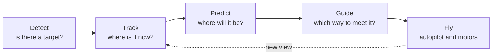

<div align="center">

# S.A.M Interception Drone

**A drone that spots a target, follows it, and intercepts it before anything
bad can happen.**

*S.A.M* is for its makers: **S**ofus, **A**lice and **M**elinoë.


[](LICENSE)

[The idea](#the-idea) ·
[How it will work](#how-it-will-work) ·
[Drone parts](hardware/parts/) ·
[Where we come from](#where-we-come-from) ·
[The team](#the-team)

</div>

---

## The idea

Some drones shouldn't be where they are. S.A.M is our answer: an
interceptor that can find a target in the air, keep it in view, predict
where it is going and meet it there, on its own and fast enough to matter.

We are building it from the ground up: the airframe on our own 3D printer,
and the software that tracks the target and flies the intercept.

## How it will work

The interceptor runs one loop, many times a second:



| Stage | Its job |
|---|---|
| **Detect** | Find the target in the onboard sensor data. |
| **Track** | Hold on to it from frame to frame, even when it moves fast or is briefly hidden. |
| **Predict** | Estimate its path a few seconds ahead. |
| **Guide** | Choose an intercept course and update it as the target manoeuvres. |
| **Fly** | Turn that course into commands for the flight controller. |

This is our plan, not yet working code. Each stage will get its own folder
and notes as it takes shape.

## What's in here

```text
.
├── hardware/
│   └── parts/     the 3D-printed drone parts: print files and photos of each print
├── legacy/        the navigation project we started from, kept as it was
├── LICENSE
└── README.md
```

## Where we come from

S.A.M started from
[PX4 ROS 2 Drone Navigation](https://github.com/formiat/px4-ros2-drone-nav)
by Alexander Aglerimov: a PX4 quadrotor that navigates dark, unmapped,
GPS-denied buildings in simulation. That project is kept whole and
unchanged in [`legacy/`](legacy/), with its own
[README](legacy/README.md), documentation and build scripts. Its
localization, mapping, planning and PX4 offboard control are a strong base
to borrow from as the interceptor grows.

## Safety

> [!WARNING]
> Intercepting another aircraft is dangerous. Everything here is tested in
> simulation first. Never fly it near people, property or other aircraft,
> and follow the drone regulations where you fly.

## The team

| | |
|---|---|
| **Sofus** | Co-creator · [@Sofustus](https://github.com/Sofustus) |
| **Alice** | Co-creator · [@Alice-watson](https://github.com/Alice-watson) |
| **Melinoë** | Co-creator · [@Lotus56](https://github.com/Lotus56) |

The legacy navigation stack is the work of Alexander Aglerimov.

## Licence

Released under the [MIT License](LICENSE).

<div align="center">
<sub>Made with care by Sofus, Alice and Melinoë.</sub>
</div>
