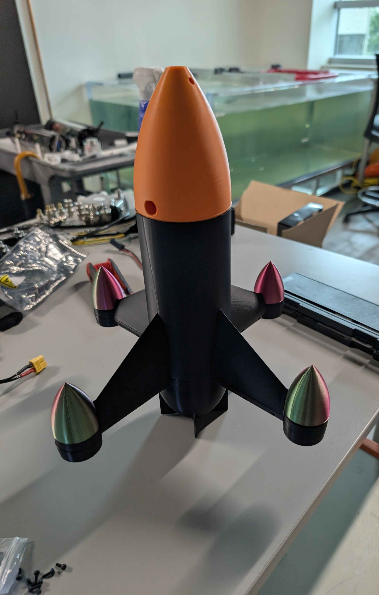
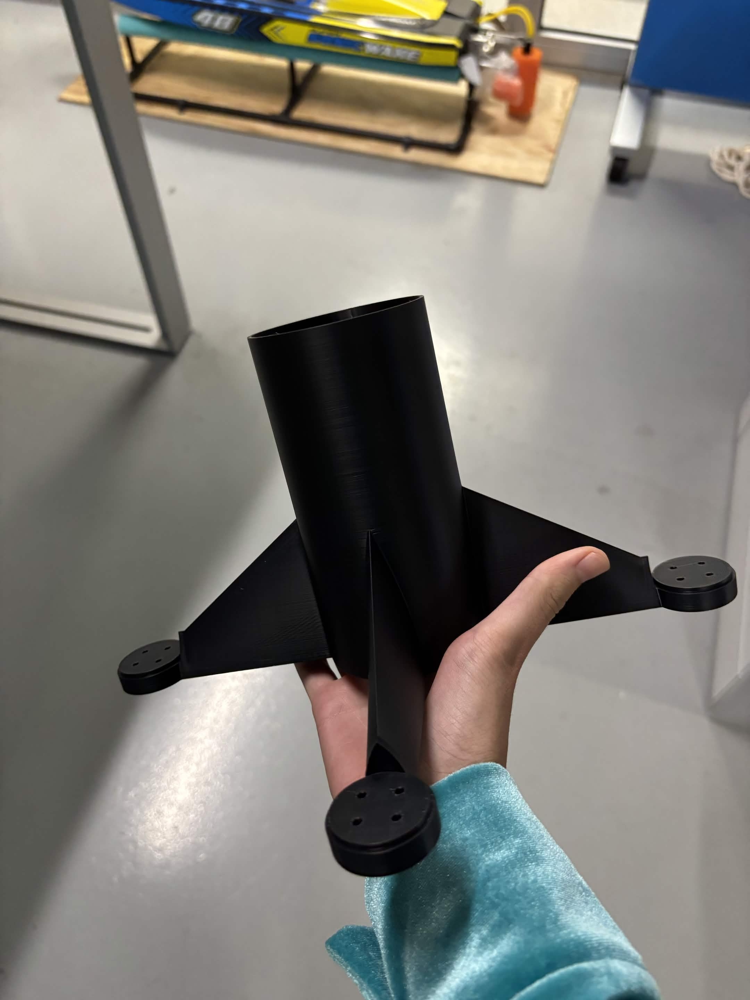
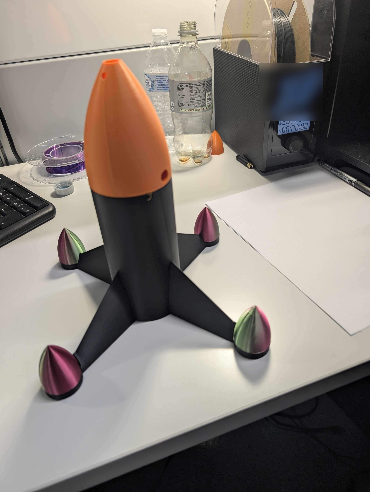

# Drone Parts

The parts of the S.A.M airframe that we print ourselves. Every part has its
print file and a photo of how the print came out, so anyone can see what
we used and what it should look like.

## The case so far

<p align="center">
  
</p>

The case is assembled, with no electronics inside yet.

## How this folder is organised

```text
hardware/parts/
├── files/     the print files (.stl, .3mf, .step), one per part
├── photos/    a photo of each finished print (.jpg or .png)
└── README.md  this page: the table of parts
```

Name a part's file and photo the same way, for example
`files/arm_front_left.stl` and `photos/arm_front_left.jpg`.

## Parts

| Part | Print file | The print | Material | Notes |
|---|---|---|---|---|
| Body and arms | [drone_bottom.gcode.3mf](files/drone_bottom.gcode.3mf) |  | PLA | The central tube with four arms, each ending in a four-hole motor mount. 0.2 mm layers, 15 % infill, about 66 g and 2 h 12 min. |
| Nose cone | [drone_nosecone.gcode.3mf](files/drone_nosecone.gcode.3mf) |  | PLA | Printed in orange. It fits on top of the body tube. 0.2 mm layers, 15 % infill, about 51 g and 1 h 32 min. |
| Motor cone caps (×4) | *file not added yet* |  | | The four multicolour caps over the motor mounts. |

Both print files are Bambu Studio projects sliced for a Bambu Lab P1S with
a 0.4 mm nozzle. Each one holds the model and its print settings.

To add a part, put its file in `files/` and its photo in `photos/`, then
add a row like this one:

```markdown
| Front-left arm | [arm_front_left.stl](files/arm_front_left.stl) |  | PETG | 20 % infill, printed flat |
```
